# 高光谱种子发芽预测系统软件架构设计

## 1. 系统概述

本系统基于高光谱技术预测种子发芽能力，实现智能分选与质量控制。采用Qt/C++框架，结合WebSocket通信协议实现实时数据传输。

系统旨在解决传统种子质量检测方法效率低、准确性不足的问题，通过高光谱成像技术捕捉种子内部生化特性，结合先进的机器学习算法，实现对种子发芽能力的精准预测。该系统不仅能提高种子分选效率，还能显著提升种子质量控制水平，为农业生产提供有力支持。

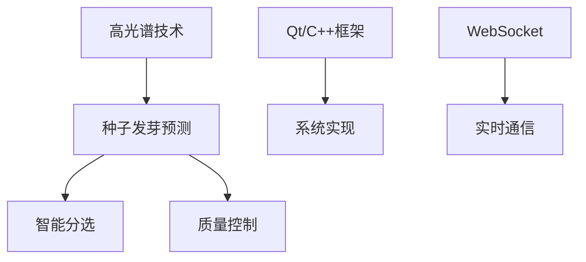

## 2. 架构设计原则

在系统设计过程中，我们始终遵循以下核心原则，确保系统的高质量和可持续发展：

- **模块化设计**：将系统划分为功能独立的模块，每个模块负责特定功能，实现高内聚低耦合
- **实时处理优先**：优化算法和数据流，确保数据采集、处理和控制的实时性，满足高速分选需求
- **可扩展性**：采用插件架构，预留标准化接口，支持新设备和算法的便捷接入
- **可靠性保障**：实现完善的错误处理和故障恢复机制，确保系统在各种条件下稳定运行
- **易维护性**：遵循清晰的代码规范，提供完整的文档，便于后期维护和升级

这些设计原则贯穿于系统的各个方面，从架构设计到具体实现，确保系统能够满足高光谱种子发芽预测的严格要求。

## 3. 系统架构总览

系统采用经典的分层架构设计，各层次职责明确，边界清晰，既保证了系统的模块化，又确保了各部分的有效协作。下图展示了系统的整体架构：

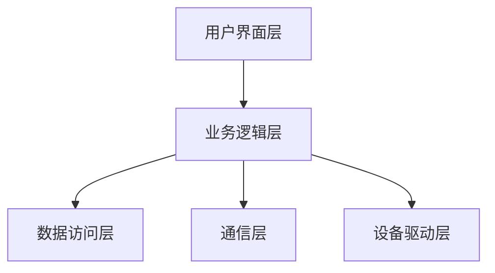

### 3.1 用户界面层详细结构

用户界面层负责与操作人员的直接交互，提供直观、友好的操作体验。该层采用Qt框架实现，具有良好的跨平台特性和丰富的UI组件。

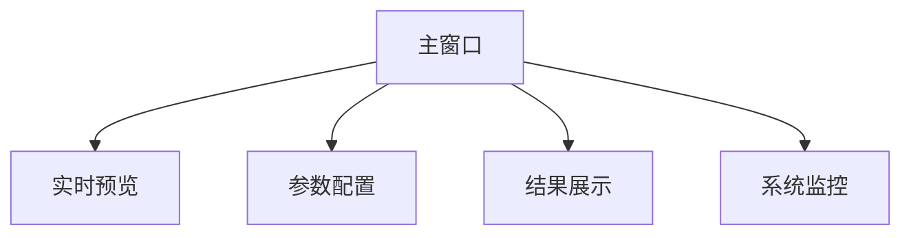

界面设计遵循人机交互原则，布局合理，操作流畅，重点突出关键信息，确保操作人员能够高效完成各项操作。

### 3.2 业务逻辑层详细结构

业务逻辑层是系统的核心，负责实现种子发芽预测的关键算法和处理流程。该层处理来自用户界面的请求，协调各个功能模块，实现系统的主要业务逻辑。

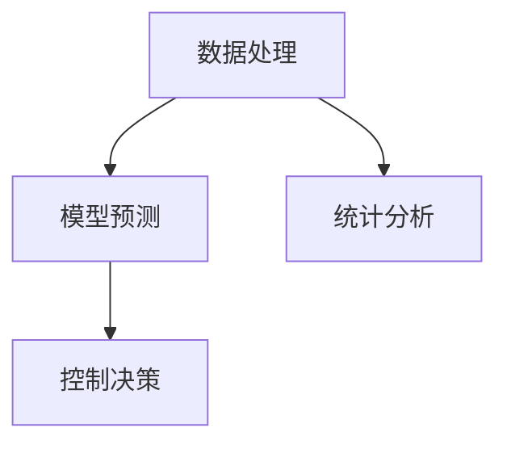

业务逻辑层采用面向对象的设计方法，各个组件之间通过定义良好的接口进行交互，保证了系统的灵活性和可维护性。

### 3.3 数据访问层详细结构

数据访问层负责系统数据的存储和管理，包括预测结果、系统配置、日志记录等。该层屏蔽了底层数据存储的细节，为上层提供统一的数据访问接口。

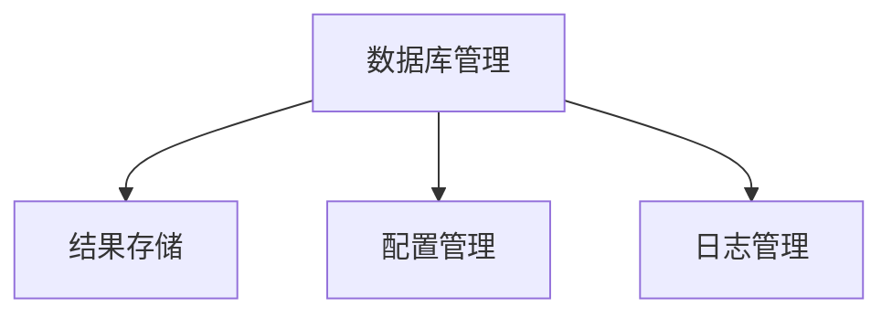

系统采用SQLite作为本地数据库，具有轻量级、高性能、零配置等特点，非常适合嵌入式应用场景。同时，系统也支持导出数据到CSV、Excel等格式，方便数据的进一步分析和利用。

### 3.4 通信层详细结构

通信层负责系统与外部系统的数据交换，采用WebSocket协议实现实时、双向的通信。该层确保了系统能够与其他系统无缝集成，形成完整的解决方案。

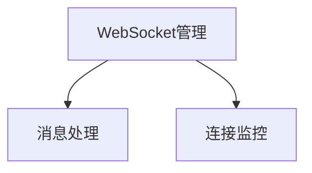

WebSocket协议具有低延迟、高效率的特点，非常适合实时数据传输的场景。系统实现了完善的连接管理和消息处理机制，确保通信的可靠性和安全性。

### 3.5 设备驱动层详细结构

设备驱动层负责与硬件设备的直接交互，包括高光谱相机、传送带、分选器等。该层封装了设备的底层细节，为上层提供统一的设备控制接口。

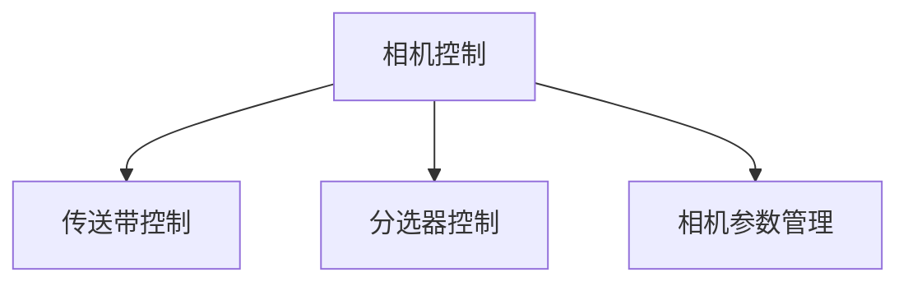

设备驱动层采用模块化设计，每种设备对应一个独立的驱动模块，通过标准接口与系统集成。这种设计使系统能够适应不同的硬件配置，提高了系统的灵活性和可扩展性。

#### 3.5.1 高光谱相机参数管理

高光谱相机参数管理是设备驱动层的重要组成部分，负责高光谱相机的参数配置、存储和加载。系统支持多种型号的高光谱相机，每种相机都有特定的参数集和配置方法。

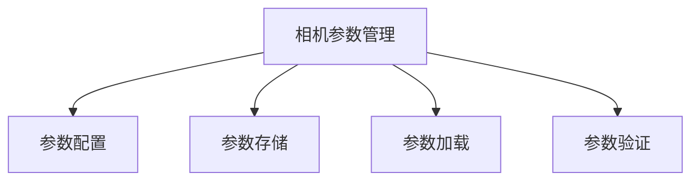

系统支持的高光谱相机参数包括：
- **曝光时间**：控制相机的曝光时间，影响图像亮度和信噪比
- **帧率**：控制相机的采集速度，需要与传送带速度匹配
- **波长范围**：设置相机采集的波长范围，根据不同种子的特性选择
- **空间分辨率**：控制图像的空间分辨率，影响处理速度和精度
- **光谱分辨率**：控制光谱的采样间隔，影响特征提取的精度
- **Binning模式**：设置像素合并模式，在速度和分辨率间取得平衡
- **增益控制**：调整信号增益，优化信噪比
- **白平衡**：校正不同波长的响应差异，确保光谱数据的准确性

系统提供了直观的参数配置界面，用户可以根据实际需求调整相机参数。同时，系统还提供了参数预设功能，用户可以保存和加载常用的参数配置，提高操作效率。

## 4. 核心模块设计

系统的核心功能由多个紧密协作的模块共同实现，每个模块专注于特定的功能领域，通过标准化接口进行交互。下面将详细介绍各个核心模块的设计。

### 4.1 模块关系图

模块间的关系设计遵循"高内聚、低耦合"原则，确保系统的可维护性和可扩展性。主窗口类作为系统的入口点，协调各个功能模块的工作。

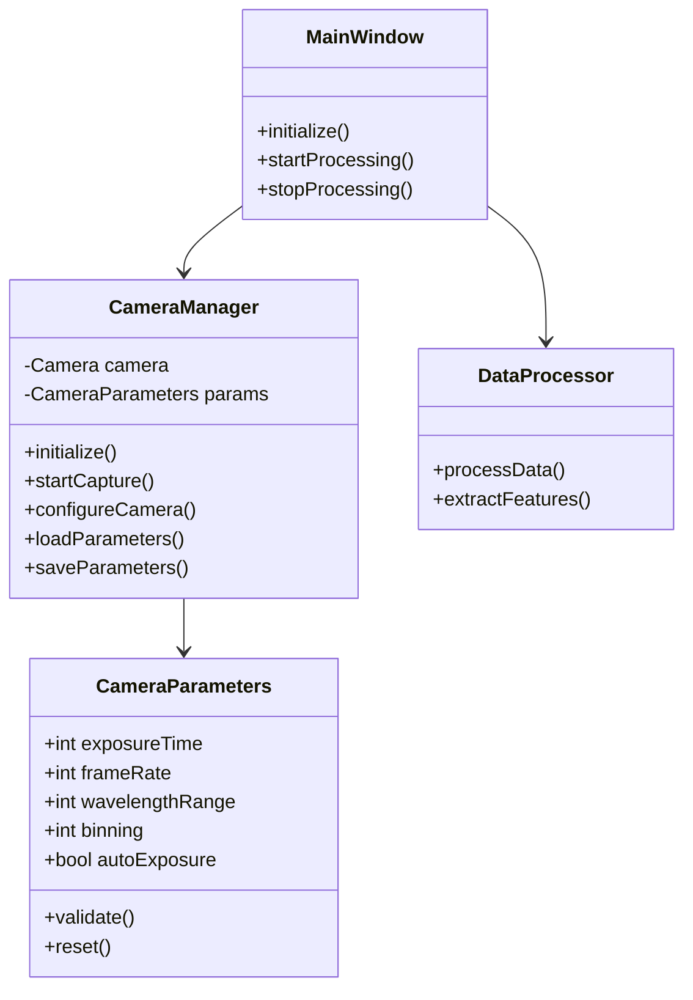

### 4.1.1 模块关系图(续)

系统的预测引擎、通信管理和配置管理是另外三个核心模块，它们与主窗口和数据处理模块协同工作，共同完成种子发芽预测的完整流程。

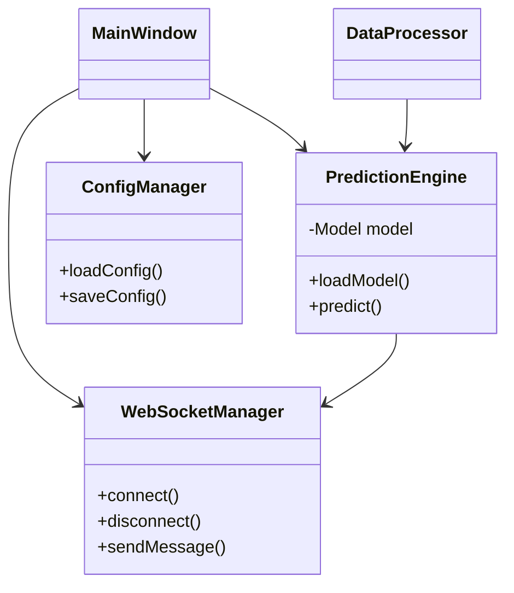

### 4.2 数据流设计

数据流设计是系统的核心部分，它定义了数据如何在系统中流动和处理。清晰的数据流设计有助于提高系统的性能和可靠性。📊

#### 4.2.1 数据采集与预处理流

数据采集阶段是整个处理流程的起点，高质量的数据采集直接影响最终预测结果的准确性。系统采用高性能的高光谱相机，配合精确的光源控制，确保采集数据的一致性和可靠性。


##### 4.2.1.1 相机参数配置与数据质量

高光谱相机参数配置对数据质量有着决定性影响。系统在数据采集前会根据当前任务自动加载相应的参数预设，或由操作人员手动调整参数。关键参数包括：

1. **曝光时间**：过短会导致信噪比低，过长则可能导致过饱和或运动模糊
2. **波长范围**：需要覆盖种子特征的关键波长区间，通常为900-1700nm
3. **光谱分辨率**：较高的分辨率可以捕获更细微的特征，但会增加数据量和处理时间
4. **空间分辨率**：需要与种子大小和传送带速度匹配，确保采集到完整的种子图像

系统会根据采集到的校准样本实时评估数据质量，并给出参数调整建议。同时，系统还会记录每次采集的参数设置，便于后续分析和优化。

预处理模块应用多种信号处理技术，如Savitzky-Golay平滑、标准正态变量变换(SNV)等，去除噪声并标准化数据，为后续特征提取做准备。预处理参数会根据相机参数自动调整，确保最佳的处理效果。

#### 4.2.2 预测与控制流

特征提取后的数据进入预测模块，系统根据预先训练好的模型进行预测，并生成控制信号指导分选执行。这一环节要求高效精确，直接关系到分选的准确性。


决策模块不仅考虑预测结果，还结合系统配置和运行状态，生成最优的控制策略，确保分选执行的准确性和效率。

#### 4.2.3 结果传输流

预测结果不仅用于本地控制，还需要传输到外部系统进行进一步处理和分析。系统采用WebSocket协议实现实时数据传输，确保数据的及时性和完整性。


通信模块实现了消息的序列化、压缩和加密，保证数据传输的效率和安全性。同时，还实现了断线重连和消息缓存机制，提高通信的可靠性。

#### 4.2.4 配置管理流

配置管理模块为系统各个组件提供参数支持，实现了参数的集中管理和动态更新。这种设计使系统能够灵活适应不同的工作场景和要求。⚙️

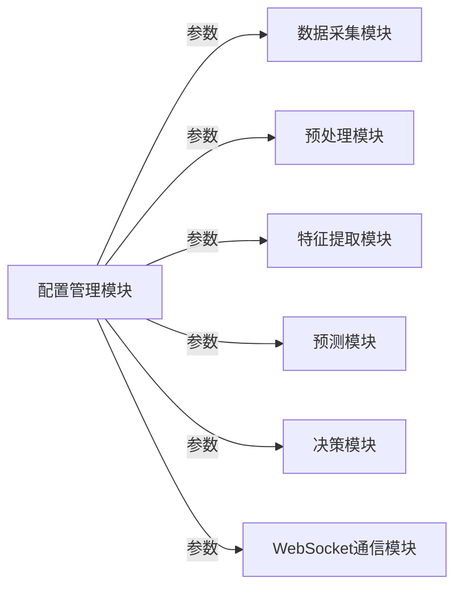

配置参数存储在本地数据库中，支持导入导出和版本管理，方便系统配置的备份和恢复。同时，系统还提供了参数验证机制，防止错误配置导致系统异常。

### 4.3 模块功能概述

下表概述了系统各核心模块的主要功能和关键组件，为系统实现提供了明确的指导。

| 模块名称 | 主要功能 | 关键组件 |
|---------|---------|---------|
| 相机控制 | 管理高光谱相机 | CameraManager, FrameReceiver, CameraParameterManager |
| 数据处理 | 数据预处理与特征提取 | DataProcessor, FeatureExtractor |
| 模型预测 | 执行种子发芽预测 | PredictionEngine, ModelManager |
| 网络通信 | 发送结果和状态信息 | WebSocketManager, MessageHandler |
| 控制决策 | 生成分选控制指令 | DecisionMaker, ControlSignalGenerator |
| 配置管理 | 管理系统参数 | ConfigManager, ParameterValidator |
| 相机参数管理 | 管理高光谱相机参数 | CameraParameterManager, ParameterPresetManager |

## 5. 通信协议设计

高效可靠的通信协议是系统与外部交互的基础。本系统采用基于WebSocket的JSON消息协议，实现了实时、双向、可靠的数据交换。🔄

### 5.1 消息结构图

系统定义了统一的消息格式，包含消息类型、时间戳、设备ID和数据内容四个主要部分。这种结构既保证了消息的完整性，又提供了足够的灵活性。

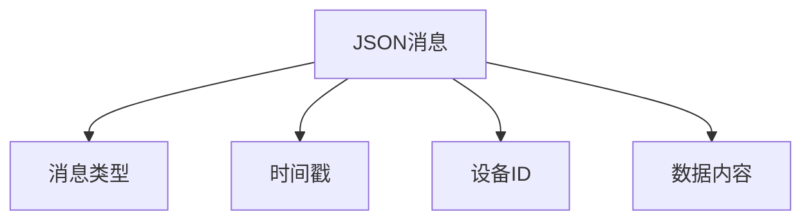

### 5.1.1 消息类型详细结构

系统支持多种消息类型，主要包括预测结果消息、系统状态消息和统计数据消息。每种消息类型都有特定的数据结构和处理逻辑。

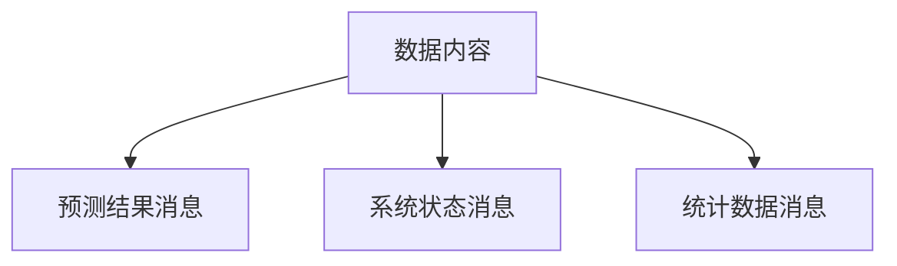

预测结果消息包含种子ID、预测结果、置信度等信息；系统状态消息包含系统运行状态、设备状态等信息；统计数据消息包含处理总数、发芽率等统计信息。

### 5.2 通信流程图

系统启动后首先建立与WebSocket服务器的连接，连接成功后才能进行后续的数据交换。这种设计确保了通信的可靠性和安全性。

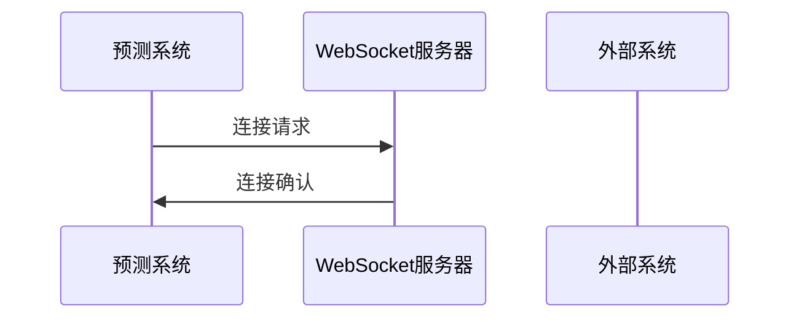

### 5.2.1 消息传输流程

连接建立后，系统会定期向服务器发送预测结果和系统状态信息。服务器接收到消息后，会将其转发给相关的外部系统进行处理。

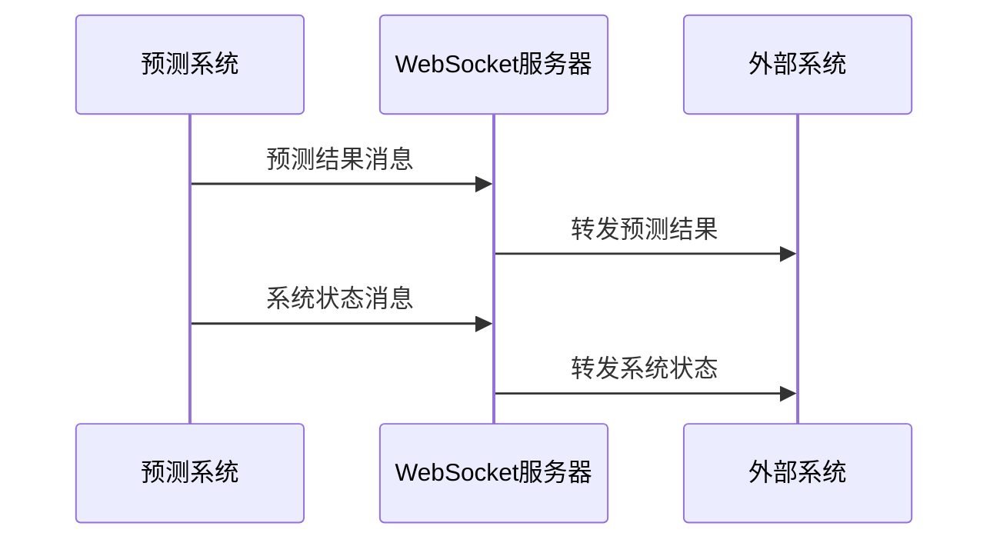

系统采用异步发送机制，消息发送不会阻塞主处理流程，确保系统的实时响应能力。同时，系统还实现了消息重传和确认机制，保证消息的可靠传递。

### 5.2.2 控制命令流程

系统不仅能发送数据，还能接收外部系统的控制命令。这种双向通信机制使系统能够与外部系统进行深度集成，形成完整的解决方案。

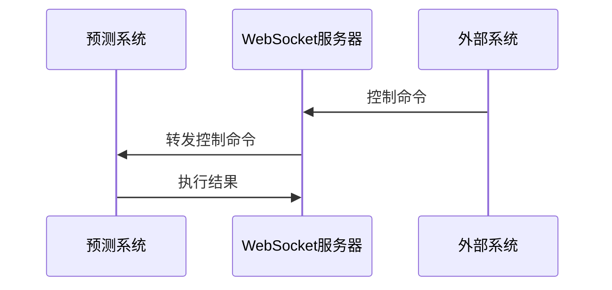

系统支持多种控制命令，如启动/停止处理、调整参数、查询状态等。每种命令都有明确的格式和处理逻辑，确保系统能够正确执行外部指令。

## 6. 多线程设计

为了充分利用现代多核处理器的性能，系统采用多线程设计，将不同的功能分配到不同的线程中执行，提高系统的并行处理能力和响应速度。⚡

### 6.1 线程结构图

系统的主线程负责用户界面交互，确保界面的响应速度。其他功能则分配到专门的工作线程中，避免阻塞主线程。

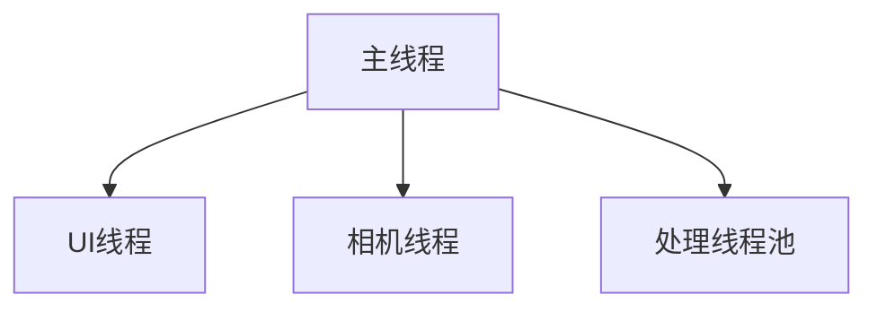

### 6.1.1 线程结构图(续)

除了基本的UI和数据采集线程外，系统还设有专门的预测线程、通信线程和控制线程，负责相应功能的执行。

```mermaid
graph TD
    A[主线程] --> E[预测线程]
    A --> F[通信线程]
    A --> G[控制线程]
```

多线程设计显著提高了系统的并行处理能力，特别是在数据采集和处理这样的计算密集型任务上，能够充分利用现代多核处理器的性能优势。

### 6.2 线程通信机制

线程间的通信是多线程系统的关键挑战。本系统采用Qt的信号槽机制实现线程间的安全通信，避免了传统多线程编程中的锁和同步问题。

```mermaid
graph TD
    B[UI线程] --> H[信号槽机制]
    C[相机线程] --> H
    D[处理线程池] --> H
    E[预测线程] --> H
    F[通信线程] --> H
    G[控制线程] --> H
```

信号槽机制不仅简化了线程间通信的编程复杂度，还提高了系统的可维护性和可扩展性。同时，系统还实现了线程池技术，优化了线程的创建和销毁过程，提高了系统的性能和稳定性。

## 7. 界面设计

良好的用户界面是系统易用性的关键。本系统采用现代化的界面设计，既美观又实用，为用户提供了直观、高效的操作体验。🖥️

### 7.1 界面布局图

系统界面采用经典的分区布局，包括顶部菜单栏、左侧工具栏、中央显示区、右侧参数面板和底部状态栏。这种布局既符合用户习惯，又能有效利用屏幕空间。

```mermaid
graph TD
    A[主界面] --> B[顶部菜单栏]
    A --> C[左侧工具栏]
    A --> D[中央显示区]
    A --> E[右侧参数面板]
    A --> F[底部状态栏]
```

### 7.1.1 中央显示区详细布局

中央显示区是界面的核心部分，主要用于显示实时预览和结果展示。这部分采用可切换的视图设计，用户可以根据需要在不同视图间切换。

```mermaid
graph TD
    D[中央显示区] --> G[实时预览]
    D --> H[结果展示]
```

实时预览视图显示高光谱相机采集的图像，并支持图像缩放、区域选择等操作；结果展示视图则以图表和列表形式展示预测结果和统计数据。

### 7.1.2 右侧参数面板详细布局

右侧参数面板用于配置系统参数和显示状态信息。该面板采用折叠式设计，用户可以根据需要展开或折叠不同部分，有效利用屏幕空间。

```mermaid
graph TD
    E[右侧参数面板] --> I[参数配置]
    E --> J[状态信息]
```

参数配置部分提供了直观的控件，如滑块、下拉框等，方便用户调整系统参数；状态信息部分则实时显示系统的运行状态、处理速度等关键指标。

### 7.2 界面功能图

#### 7.2.1 主要界面分类

系统包含多个功能界面，用户可以通过菜单或工具栏在不同界面间切换。每个界面都专注于特定的功能，避免了功能的混杂和界面的复杂化。

```mermaid
graph TD
    A[系统界面] --> B[主界面]
    A --> C[配置界面]
    A --> D[数据管理界面]
    A --> E[系统监控界面]
```

#### 7.2.2 主界面功能

主界面是系统的核心操作界面，集中了最常用的功能，包括实时预览、控制面板和结果展示。用户可以在这个界面完成大部分日常操作。

```mermaid
graph TD
    B[主界面] --> F[实时预览区]
    B --> G[控制面板]
    B --> H[结果展示区]
```

控制面板提供了启动/停止处理、调整参数等常用操作；结果展示区则实时显示预测结果和统计数据，帮助用户了解系统的工作状态和效果。

#### 7.2.3 配置界面功能

配置界面用于系统的详细设置，包括相机配置、算法配置、系统配置和设备配置。这个界面提供了更为详细的参数设置选项，满足高级用户的需求。

```mermaid
graph TD
    C[配置界面] --> I[相机配置]
    C --> J[算法配置]
    C --> K[系统配置]
    C --> L[设备配置]
    I --> I1[基本参数]
    I --> I2[高级参数]
    I --> I3[参数预设]
```

配置界面采用标签页设计，将不同类别的配置分组显示，使界面既全面又不显得混乱。同时，系统还提供了配置的导入导出功能，方便配置的备份和恢复。

##### 7.2.3.1 高光谱相机配置界面

高光谱相机配置界面是配置界面的重要组成部分，提供了全面的相机参数设置功能。界面设计遵循直观、易用的原则，即使是非专业用户也能轻松完成相机配置。

```mermaid
graph TD
    I1[基本参数] --> P1[曝光时间]
    I1 --> P2[帧率]
    I1 --> P3[波长范围]
    I2[高级参数] --> P4[空间分辨率]
    I2 --> P5[光谱分辨率]
    I2 --> P6[Binning模式]
    I2 --> P7[增益控制]
    I2 --> P8[白平衡]
    I3[参数预设] --> P9[保存预设]
    I3 --> P10[加载预设]
    I3 --> P11[管理预设]
```

基本参数区域提供了最常用的相机参数设置，如曝光时间、帧率和波长范围。这些参数直接影响图像质量和采集速度，用户可以通过滑块或输入框进行调整。系统会实时显示参数变化对图像的影响，帮助用户找到最佳设置。

高级参数区域提供了更为专业的相机参数设置，如空间分辨率、光谱分辨率、Binning模式等。这些参数主要面向专业用户，能够更精细地控制相机性能。系统提供了参数说明和推荐值，帮助用户理解和设置这些参数。

参数预设区域允许用户保存和加载常用的参数配置。用户可以为不同种类的种子创建专用的参数预设，在切换检测对象时快速应用适合的相机设置。系统还提供了预设管理功能，支持预设的重命名、删除和导出。

#### 7.2.4 数据管理界面功能

数据管理界面用于历史数据的查询、可视化和导出。用户可以在这个界面查看历史预测结果，分析系统性能，并将数据导出为多种格式。

```mermaid
graph TD
    D[数据管理界面] --> M[数据查询]
    D --> N[数据可视化]
    D --> O[数据导出]
```

数据查询部分支持多种查询条件，如时间范围、批次号等；数据可视化部分提供了丰富的图表类型，如饼图、折线图等；数据导出部分则支持CSV、Excel等多种格式。

#### 7.2.5 系统监控界面功能

系统监控界面用于监控系统的运行状态，包括设备状态、性能监控和告警管理。这个界面帮助用户及时发现和解决系统问题，确保系统的稳定运行。

```mermaid
graph TD
    E[系统监控界面] --> P[设备状态]
    E --> Q[性能监控]
    E --> R[告警管理]
```

设备状态部分显示各设备的连接状态和工作状态；性能监控部分显示CPU使用率、内存使用率等性能指标；告警管理部分则显示系统的告警信息，并支持告警的确认和处理。

### 7.3 界面交互流程

系统的界面交互流程设计遵循"简单、直观、高效"的原则，确保用户能够轻松上手，高效操作。

```mermaid
stateDiagram-v2
    [*] --> 启动
    启动 --> 初始化
    初始化 --> 就绪
    就绪 --> 处理中: 启动处理
    处理中 --> 就绪: 停止处理
```

系统启动后进入初始化状态，完成设备连接和参数加载后进入就绪状态。用户可以在就绪状态下启动处理，系统进入处理中状态；也可以在处理中状态下停止处理，系统返回就绪状态。

#### 7.3.1 配置流程

配置流程是系统使用中的重要环节，良好的配置流程设计能够提高系统的易用性和可靠性。

```mermaid
stateDiagram-v2
    就绪 --> 配置: 打开配置
    配置 --> 就绪: 保存配置
    就绪 --> [*]: 退出系统
```

用户可以在就绪状态下打开配置界面，调整系统参数；完成配置后保存并返回就绪状态。系统会验证配置参数的有效性，确保系统能够正常工作。

## 8. 部署方案

系统的部署是项目成功的关键环节。本系统采用模块化的部署方案，确保部署过程的简单高效，同时保证系统的稳定可靠。🚀

### 8.1 部署流程图

部署流程从开发环境开始，经过构建系统生成安装包，最终部署到目标系统。这个过程需要严格的测试和验证，确保部署的质量。

```mermaid
graph TD
    A[开发环境] --> B[构建系统]
    B --> C[安装包]
    C --> D[目标系统]
```

构建系统采用CMake工具链，支持跨平台构建，生成针对不同目标系统的安装包。安装包包含所有必要的组件和依赖，确保系统能够在目标环境中正常运行。

### 8.2 环境配置流程

系统部署到目标环境后，需要进行环境配置、系统启动、功能验证和性能优化等步骤，确保系统能够在实际环境中稳定运行。

```mermaid
graph TD
    D[目标系统] --> E[运行环境配置]
    E --> F[系统启动]
    F --> G[功能验证]
    G --> H[性能优化]
```

运行环境配置包括安装依赖库、配置系统参数等；功能验证包括基本功能测试、性能测试等；性能优化则根据实际运行情况调整系统参数，提高系统性能。

### 8.3 运行环境要求

系统对运行环境有一定的要求，包括硬件和软件两方面。下表列出了系统运行的最低要求和推荐配置。

| 类别 | 要求 |
|------|------|
| 操作系统 | Windows 10/11 64位 |
| CPU | 8核以上，3.0GHz+ |
| 内存 | 16GB以上 |
| GPU | NVIDIA GTX 1660以上 |
| 存储 | SSD 256GB以上 |
| 依赖库 | Qt 6.5+, OpenCV 4.5+ |
| 相机接口 | Camera Link, GigE Vision 或 USB 3.0 |

#### 8.3.1 高光谱相机要求

系统支持多种型号的高光谱相机，但为了获得最佳性能，相机需要满足以下要求：

| 参数 | 最低要求 | 推荐配置 |
|------|---------|---------|
| 波长范围 | 900-1700nm | 400-2500nm |
| 光谱分辨率 | 10nm | 3-5nm |
| 空间分辨率 | 320像素 | 640像素或更高 |
| 帧率 | 30fps | 100fps或更高 |
| 接口 | Camera Link | Camera Link或GigE Vision |
| 位深度 | 12位 | 14-16位 |

系统提供了多种相机驱动，支持市场上主流的高光谱相机品牌和型号。用户可以根据实际需求和预算选择合适的相机，系统会自动识别相机型号并加载相应的驱动和默认参数。

系统对硬件的要求较高，特别是CPU和GPU，这是由高光谱数据处理和模型推理的计算密集特性决定的。使用高性能硬件能够显著提高系统的处理速度和响应能力。

## 9. 开发计划

合理的开发计划是项目成功的保障。本项目采用敏捷开发方法，将开发过程分为多个迭代，每个迭代都有明确的目标和交付物。📅

### 9.1 开发阶段甘特图

开发的第一阶段是基础框架的搭建和核心功能的实现。这个阶段的重点是构建系统的基本框架，实现核心功能模块，为后续开发奠定基础。


框架搭建包括项目结构设计、基本类的定义、界面原型的实现等；核心功能实现则包括数据采集、预处理、特征提取等关键功能的开发。

### 9.2 功能模块开发甘特图

第二阶段是功能模块的开发和单元测试。这个阶段的重点是完善各个功能模块，确保每个模块都能够正常工作，并通过单元测试验证其功能的正确性。

```mermaid
gantt
    title 功能模块开发
    dateFormat  YYYY-MM-DD
    section 功能模块
    模块开发      :b1, 2024-07-13, 7d
    单元测试      :b2, after b1, 3d
```

模块开发包括预测引擎、通信模块、界面功能等各个模块的实现；单元测试则针对每个模块编写测试用例，验证其功能的正确性和稳定性。

### 9.3 集成与部署甘特图

最后一个阶段是系统集成、性能优化和部署验证。这个阶段的重点是将各个模块集成为完整的系统，优化系统性能，并在实际环境中验证系统的功能和性能。

```mermaid
gantt
    title 集成与部署
    dateFormat  YYYY-MM-DD
    section 系统集成
    集成测试      :c1, 2024-07-23, 3d
    性能优化      :c2, after c1, 2d
    section 部署验证
    系统部署      :d1, after c2, 1d
    验证测试      :d2, after d1, 2d
```

集成测试验证各个模块的协同工作能力；性能优化针对系统的瓶颈进行优化，提高系统的处理速度和响应能力；系统部署将系统部署到实际环境中；验证测试则在实际环境中验证系统的功能和性能。

## 10. 总结

本文档详细描述了高光谱种子发芽预测系统的软件架构设计，采用分层架构和模块化设计原则，确保系统具有高性能、高可靠性和良好的扩展性。系统基于Qt/C++框架开发，通过WebSocket实现实时数据传输，能够满足高光谱种子发芽预测的需求。📈

系统将在一个月内完成开发，并通过持续优化提升性能和可靠性。我们相信，这套系统将为种子质量控制提供强有力的技术支持，为农业生产效率的提升做出贡献。🌱

