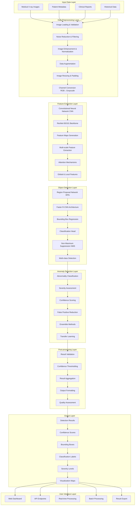
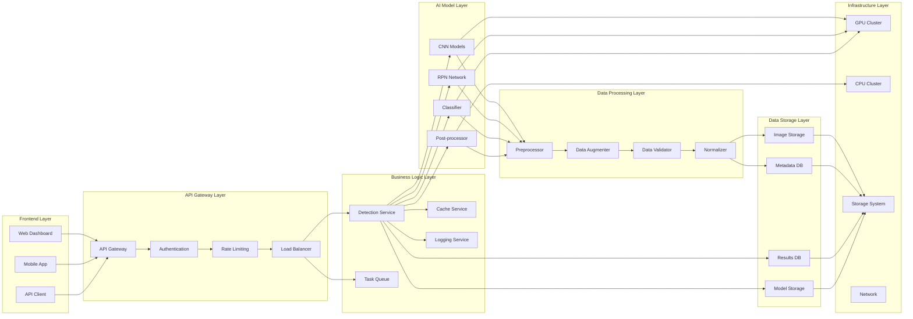
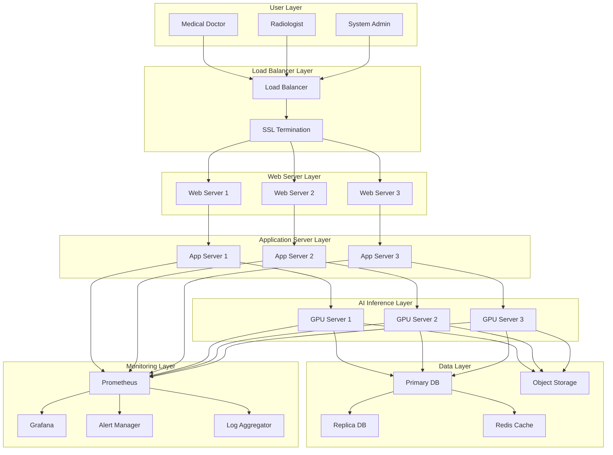

# X-ray检测系统框架图 - Mermaid代码

## 系统整体架构图

## 数据流程图

```mermaid
flowchart LR
    %% 数据输入
    Input[Medical X-ray Images] --> Preprocess[Data Preprocessing]
    
    %% 预处理步骤
    Preprocess --> |1. Load & Validate| Load[Image Loading]
    Load --> |2. Clean & Filter| Clean[Noise Reduction]
    Clean --> |3. Enhance & Normalize| Enhance[Image Enhancement]
    Enhance --> |4. Augment Data| Augment[Data Augmentation]
    Augment --> |5. Resize & Pad| Resize[Image Resizing]
    Resize --> |6. Convert Channels| Convert[Channel Conversion]
    
    %% 特征提取
    Convert --> |7. Extract Features| CNN[CNN Feature Extraction]
    CNN --> |8. Generate Feature Maps| Features[Feature Maps]
    Features --> |9. Multi-scale Features| MultiScale[Multi-scale Features]
    
    %% 目标检测
    MultiScale --> |10. Region Proposals| RPN[RPN Network]
    RPN --> |11. Object Detection| Detection[Faster R-CNN]
    Detection --> |12. Bounding Boxes| BBox[Bounding Boxes]
    BBox --> |13. Classification| Classify[Classification]
    
    %% 异常检测
    Classify --> |14. Abnormality Detection| Abnormal[Abnormality Detection]
    Abnormal --> |15. Severity Assessment| Severity[Severity Assessment]
    Abnormal --> |16. Confidence Scoring| Confidence[Confidence Scoring]
    
    %% 后处理
    Severity --> |17. Result Validation| Validate[Validation]
    Confidence --> |17. Result Validation| Validate
    Validate --> |18. Confidence Thresholding| Threshold[Thresholding]
    Threshold --> |19. Result Aggregation| Aggregate[Aggregation]
    Aggregate --> |20. Output Formatting| Format[Formatting]
    
    %% 结果输出
    Format --> |21. Final Results| Results[Detection Results]
    Results --> |22. Visualization| Visual[Visualization]
    Results --> |23. API Response| API[API Response]
    Results --> |24. Database Storage| DB[Database]
    
    %% 用户界面
    Visual --> |25. Web Dashboard| Dashboard[Web Dashboard]
    API --> |26. API Endpoints| Endpoints[API Endpoints]
    DB --> |27. Data Retrieval| Retrieve[Data Retrieval]
```

## 技术架构图

## 部署架构图

## 使用说明

1. **复制Mermaid代码**：选择上面任意一个图表代码块
2. **粘贴到支持Mermaid的平台**：
   - GitHub (在Markdown文件中)
   - GitLab
   - Notion
   - Mermaid Live Editor (https://mermaid.live/)
   - 其他支持Mermaid的平台

3. **自定义修改**：
   - 修改节点名称和描述
   - 调整连接关系
   - 更改颜色和样式
   - 添加或删除组件

4. **导出格式**：
   - PNG图片
   - SVG矢量图
   - PDF文档
   - 其他支持的格式

这些Mermaid图表展示了X-ray检测系统的完整架构，包括数据流、技术栈、部署结构等各个方面。 